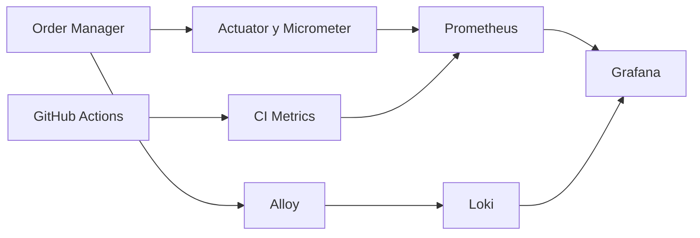

# Order Manager - Evaluacion Parcial 3 DevOps

**Estudiante:** Francisco Osorio
**Asignatura:** Ingenieria DevOps
**Rama:** evaluacion-3

## Descripcion del proyecto

Order Manager es un microservicio desarrollado con Spring Boot que permite gestionar pedidos de clientes mediante una API REST, durante la segunda evaluacion se implemento un pipeline CI/CD con pruebas automatizadas, analisis de calidad, Docker y persistencia de datos

Para esta tercera evaluacion se continuo trabajando sobre el mismo proyecto, incorporando herramientas de monitoreo, centralizacion de logs, metricas de cobertura, tiempos de despliegue y politicas de seguridad que permiten detectar y bloquear errores de manera automatica

## Tecnologias utilizadas

| Tecnologia | Uso en el proyecto |
|---|---|
| Java 17 y Spring Boot | Desarrollo del microservicio |
| Maven | Compilacion y gestion de dependencias |
| JUnit, Mockito y MockMvc | Pruebas automatizadas |
| JaCoCo | Cobertura de pruebas |
| SonarQube Cloud | Calidad y seguridad del codigo |
| GitHub Actions | Pipeline CI/CD |
| Dependabot | Revision de dependencias |
| Docker y Docker Compose | Ejecucion de los servicios |
| PostgreSQL | Persistencia de datos |
| H2 | Base de datos en memoria |
| Actuator y Micrometer | Metricas del microservicio |
| Prometheus | Recoleccion de metricas |
| Grafana | Visualizacion de metricas y logs |
| Loki | Centralizacion de logs |
| Grafana Alloy | Recoleccion de logs |
| Python | Automatizacion de metricas y auditoria |
| jq | Validacion de respuestas JSON |

## Arquitectura del proyecto

El proyecto cuenta con siete contenedores que se comunican mediante una red interna de Docker, cada uno cumple una funcion dentro del entorno, permitiendo mantener el funcionamiento del microservicio, la persistencia de datos y el monitoreo de sus actividades

| Servicio | Funcion | Puerto |
|---|---|---|
| app | Microservicio Order Manager | 8098 |
| db | Base de datos PostgreSQL | Interno |
| prometheus | Recoleccion de metricas | 9090 |
| grafana | Dashboard de observabilidad | 3000 |
| loki | Almacenamiento de logs | 3100 |
| alloy | Recoleccion de logs | 12345 |
| ci-metrics | Metricas del pipeline | 9101 |

### Flujo de observabilidad



## Requisitos

- Git
- Docker Desktop
- Docker Compose
- Conexion a internet

En caso de querer ejecutar el microservicio o realizar las pruebas sin utilizar Docker, tambien sera necesario contar con Java 17 y Maven

## Instalacion y ejecucion

Para comenzar se debe clonar el repositorio utilizando la rama correspondiente a la tercera evaluacion

```cmd
git clone -b evaluacion-3 https://github.com/P4NXO14/order-manager-ep2.git
cd order-manager-ep2
```

Comprobar que Docker Desktop se encuentre iniciado

```cmd
docker info
```

Una vez clonado el repositorio se debe crear un archivo `.env` dentro de la carpeta principal del proyecto, junto al archivo `docker-compose.yml`, con el siguiente contenido

```dotenv
POSTGRES_PASSWORD=CAMBIAR_POR_CLAVE_SEGURA
GRAFANA_ADMIN_USER=admin
GRAFANA_ADMIN_PASSWORD=CAMBIAR_POR_CLAVE_SEGURA
GITHUB_METRICS_TOKEN=
```

Las contraseñas deben reemplazarse por valores propios, este archivo se encuentra dentro de `.gitignore` para evitar que las credenciales utilizadas sean publicadas en GitHub

Para iniciar los siete contenedores se debe ejecutar

```cmd
docker compose --env-file .env up -d --build
```

Comprobar que los contenedores se encuentren funcionando

```cmd
docker compose --env-file .env ps
```

Para detener los contenedores sin perder los datos almacenados

```cmd
docker compose --env-file .env down
```

Es importante **no** utilizar `docker compose down -v` si se desea conservar la informacion almacenada en los volumenes, dado a que este comando elimina los datos que se encuentran dentro de ellos

## Ejecucion sin Docker

Para realizar las pruebas automatizadas

```cmd
mvn clean verify
```

Para iniciar solamente el microservicio

```cmd
mvn spring-boot:run
```

Al ejecutar el proyecto de esta manera se utiliza H2 como base de datos en memoria, las herramientas externas de monitoreo no se inician automaticamente

## Funcionalidades de la API

El microservicio permite realizar distintas operaciones relacionadas con la gestion de pedidos, entre ellas se encuentra la creacion, consulta y eliminacion de pedidos, ademas de la administracion de sus productos y estados

| Metodo | Endpoint | Funcion |
|---|---|---|
| GET | /api/orders | Consultar pedidos |
| GET | /api/orders/{id} | Consultar un pedido |
| GET | /api/orders/status/{status} | Consultar por estado |
| POST | /api/orders | Crear pedido |
| POST | /api/orders/{id}/items | Agregar producto |
| PUT | /api/orders/{id}/confirm | Confirmar pedido |
| PUT | /api/orders/{id}/ship | Enviar pedido |
| PUT | /api/orders/{id}/deliver | Entregar pedido |
| PUT | /api/orders/{id}/cancel | Cancelar pedido |
| DELETE | /api/orders/{id} | Eliminar pedido |

URL base: http://localhost:8098

## Acceso a las herramientas

Una vez iniciados los contenedores se puede acceder a las distintas herramientas mediante las siguientes direcciones

| Herramienta | Direccion |
|---|---|
| Estado del microservicio | http://localhost:8098/actuator/health |
| Informacion del microservicio | http://localhost:8098/actuator/info |
| Metricas disponibles | http://localhost:8098/actuator/metrics |
| Metricas Prometheus | http://localhost:8098/actuator/prometheus |
| Prometheus | http://localhost:9090 |
| Targets de Prometheus | http://localhost:9090/targets |
| Grafana | http://localhost:3000 |
| Loki | http://localhost:3100/ready |
| Alloy | http://localhost:12345 |
| Metricas CI/CD | http://localhost:9101/metrics |

Para ingresar a Grafana se deben utilizar las credenciales que fueron ingresadas anteriormente en el archivo `.env`

El dashboard se encuentra dentro de

**Dashboards > Order Manager > Order Manager - Observabilidad**

## Dashboard de observabilidad

Se creo un dashboard personalizado dentro de Grafana que cuenta con 13 paneles, los cuales permiten visualizar el estado del microservicio y los resultados obtenidos mediante el pipeline CI/CD

Las metricas que se pueden visualizar son

- Disponibilidad y tiempo de actividad del microservicio
- Peticiones HTTP acumuladas y por segundo
- Uso de CPU y memoria JVM
- Tiempo promedio de respuesta
- Errores HTTP 4xx y 5xx
- Cobertura de instrucciones, ramas y lineas
- Tiempo de despliegue del pipeline

Para generar trafico de prueba desde CMD

```cmd
for /L %i in (1,1,50) do curl -s -o NUL http://localhost:8098/api/orders
```

Para generar errores HTTP 404 de manera controlada

```cmd
for /L %i in (1,1,20) do curl -s -o NUL http://localhost:8098/ruta-inexistente
```

Al realizar estas pruebas se pueden apreciar los cambios que se generan dentro del dashboard de Grafana, permitiendo comprobar que las metricas estan siendo recolectadas correctamente

## Centralizacion de logs

Para la centralizacion de logs se utilizo Grafana Alloy, el cual se encarga de recolectar los registros generados por el contenedor de Order Manager y enviarlos a Loki, de esta manera se pueden consultar los registros directamente desde Grafana sin necesidad de ingresar al contenedor

Para revisar los registros se debe ingresar a Explore dentro de Grafana, seleccionar Loki como fuente de datos y utilizar el modo Code para realizar las siguientes consultas

Todos los registros

```logql
{service="order-manager"}
```

Advertencias

```logql
{service="order-manager"} |= "WARN"
```

Errores

```logql
{service="order-manager"} |= "ERROR"
```

Recursos no encontrados

```logql
{service="order-manager"} |= "Recurso no encontrado"
```

## Pipeline CI/CD

El pipeline se encuentra dentro del archivo `.github/workflows/ci-cd.yml` y se ejecuta de manera automatica al realizar un Push o Pull Request en las ramas configuradas, tambien cuenta con la opcion de ejecutarse manualmente desde GitHub Actions

Este se encuentra dividido en dos trabajos principales

### Pruebas, cobertura y SonarQube

- Auditoria de cumplimiento
- Compilacion y pruebas automatizadas
- Validacion de cobertura con JaCoCo
- Analisis de calidad y seguridad con SonarQube
- Validacion del Quality Gate
- Generacion de reportes

### Despliegue simulado con Docker

- Construccion de la imagen Docker
- Inicio de los siete contenedores
- Medicion del tiempo de despliegue
- Validacion de disponibilidad y observabilidad
- Comprobacion de metricas y logs
- Creacion de un pedido de prueba
- Validacion de persistencia en PostgreSQL
- Publicacion de metricas
- Limpieza del entorno

En caso de que el primer trabajo falle, el despliegue **no** se ejecuta, evitando que se realice un despliegue que no cumpla con las condiciones establecidas

Al realizar un Pull Request solamente se ejecutan las comprobaciones de calidad y seguridad, dado a que el objetivo es validar los cambios antes de incorporarlos a la rama correspondiente

## Resultados de calidad

Durante el desarrollo de esta evaluacion se incorporaron nuevas pruebas automatizadas, logrando mejorar los porcentajes de cobertura obtenidos en la evaluacion anterior y cumplir con las condiciones establecidas por SonarQube

| Indicador | Resultado |
|---|---:|
| Cobertura de instrucciones | 93,22% |
| Cobertura de ramas | 98,15% |
| Cobertura de lineas | 93,72% |
| Cobertura del codigo nuevo | 100% |
| Duplicacion del codigo nuevo | 0,0% |
| Nuevos problemas en SonarQube | 0 |
| Security Hotspots | 0 |
| Quality Gate | Passed |
| Tiempo de despliegue, ejecucion #33 | 20 segundos |

JaCoCo exige una cobertura minima del 75% de instrucciones, mientras que SonarQube exige un minimo del 80% de cobertura sobre el codigo nuevo, ambos requisitos fueron superados durante las pruebas realizadas

El tiempo de despliegue puede variar dependiendo de cada ejecucion del pipeline

## Automatizacion de metricas

Para poder visualizar los resultados del pipeline dentro de Grafana se utilizaron scripts desarrollados en Python, los cuales permiten obtener las metricas de cobertura y tiempo de despliegue desde GitHub Actions, evitando tener que descargar y actualizar los resultados de manera manual

Los archivos utilizados se encuentran dentro de `monitoring/ci`

| Archivo | Funcion |
|---|---|
| exportar_metricas.py | Obtener resultados de JaCoCo |
| actualizar_metricas.py | Recuperar metricas desde GitHub Actions |
| servidor_metricas.py | Exponer metricas para Prometheus |
| auditar_cumplimiento.py | Validar politicas de cumplimiento |
| metricas.prom | Almacenar los resultados |

Para habilitar la actualizacion automatica de metricas se debe generar un Fine-grained personal access token en GitHub, seleccionando el repositorio `order-manager-ep2` y otorgando los siguientes permisos

- Actions: Read-only
- Metadata: Read-only

Una vez generado el token se debe ingresar dentro de la variable `GITHUB_METRICS_TOKEN` del archivo `.env`

Despues de ingresar el token se debe recrear el contenedor encargado de las metricas

```cmd
docker compose --env-file .env up -d --force-recreate ci-metrics
```

Para comprobar que las metricas se esten actualizando correctamente

```cmd
docker compose --env-file .env logs --tail=30 ci-metrics
```

El token utilizado para SonarQube es independiente y se encuentra configurado dentro de los secretos de GitHub Actions con el nombre `SONAR_TOKEN`

## Politicas de cumplimiento y seguridad

Se implemento un script de auditoria automatizada que permite verificar 12 condiciones dentro de Docker Compose, esto permite detectar configuraciones que puedan generar problemas de seguridad antes de realizar el despliegue

Las condiciones que se verifican estan relacionadas con

- Presencia de los siete servicios
- Ausencia de contenedores privilegiados
- Aislamiento de red
- Restriccion de los cinco puertos de monitoreo a localhost
- PostgreSQL sin puertos publicados
- Healthchecks del microservicio y la base de datos
- Montaje del socket Docker de Alloy en modo de solo lectura

Para ejecutar la auditoria de manera local desde CMD se deben tener los contenedores iniciados

```cmd
docker compose --env-file .env config --format json | docker compose --env-file .env exec -T ci-metrics python /metrics/auditar_cumplimiento.py --stdin
```

La auditoria devuelve un codigo de salida 0 cuando todas las condiciones se cumplen y un codigo de salida 1 cuando se detecta algun incumplimiento, de esta manera se logra bloquear el pipeline antes de realizar el despliegue

Ademas se creo el Ruleset `Proteccion-main-EP3` dentro de GitHub, con el objetivo de proteger la rama principal del repositorio mediante las siguientes condiciones

- Uso obligatorio de Pull Requests
- Comprobaciones de GitHub Actions aprobadas
- Validacion del Quality Gate
- Resolucion de conversaciones
- Ramas actualizadas antes de fusionar cambios
- Bloqueo de force push
- Restriccion de eliminacion de la rama principal

## Pruebas de incumplimiento

Durante el desarrollo del proyecto se realizaron distintas pruebas para comprobar que el pipeline fuera capaz de detectar errores y bloquear los cambios que **no** cumplen con las condiciones establecidas

| Prueba | Resultado |
|---|---|
| Cobertura insuficiente | Quality Gate rechazado |
| Problemas de seguridad | Quality Gate rechazado |
| Quality Gate fallido | Despliegue bloqueado |
| Puerto inseguro de Grafana | Auditoria rechazada |
| Pull Request con incumplimiento | Fusion bloqueada |
| Configuracion correcta | Pipeline aprobado |

Para comprobar el funcionamiento de la auditoria se creo una rama temporal en la cual se modifico el puerto de Grafana, simulando una configuracion insegura sin afectar el funcionamiento del proyecto principal

El resultado obtenido fue de 11 controles aprobados y 1 rechazado, lo que provoco que GitHub bloqueara la fusion del Pull Request, logrando demostrar que las politicas implementadas funcionan correctamente y que la configuracion insegura **no** fue desplegada

## Artefactos generados

Durante las ejecuciones del pipeline se generan distintos artefactos que permiten revisar los resultados obtenidos y mantener evidencias de las pruebas realizadas

| Artefacto | Contenido |
|---|---|
| metricas-cobertura | Resultados de cobertura |
| reportes-pruebas-jacoco | Pruebas y reportes JaCoCo |
| metricas-pipeline | Cobertura y tiempo de despliegue |
| reporte-cumplimiento | Resultado de la auditoria |

El reporte de cumplimiento tambien permite identificar el commit, la ejecucion, la referencia de Git y la fecha en que se realizo la auditoria, permitiendo mantener un registro de las comprobaciones realizadas

## Evidencias y enlaces

- [Repositorio GitHub](https://github.com/P4NXO14/order-manager-ep2)
- [Rama Evaluacion 3](https://github.com/P4NXO14/order-manager-ep2/tree/evaluacion-3)
- [GitHub Actions](https://github.com/P4NXO14/order-manager-ep2/actions)
- [SonarQube Cloud](https://sonarcloud.io/dashboard?id=P4NXO14_order-manager-ep2&branch=evaluacion-3)
- [Pull Request de validacion exitosa](https://github.com/P4NXO14/order-manager-ep2/pull/14)
- [Pull Request de incumplimiento](https://github.com/P4NXO14/order-manager-ep2/pull/15)

La documentacion correspondiente a las distintas fases del proyecto se encuentra dentro de `docs/fases`

## Alcance y limitaciones

El proyecto fue desarrollado y validado mediante Docker Desktop y GitHub Actions, utilizando un entorno de despliegue simulado, dado a que **no** se realizo el despliegue en AWS

Las politicas de seguridad implementadas corresponden a controles internos del proyecto y no representan una certificacion normativa formal, ademas se debe considerar que el puerto del microservicio se encuentra publicado y que Alloy mantiene acceso al socket de Docker, lo que puede generar riesgos dentro de un entorno de produccion

## Uso de inteligencia artificial

Durante el desarrollo se utilizo ChatGPT como herramienta de apoyo para comprender los requisitos y solucionar errores

## Conclusion

Esta evaluacion permitio mejorar el proyecto anterior incorporando herramientas de monitoreo, observabilidad y seguridad al pipeline CI/CD, se logro automatizar la visualizacion de metricas, centralizar los registros y establecer politicas que permiten detectar errores antes de realizar el despliegue, las pruebas realizadas demostraron que el entorno funciona correctamente y que el pipeline es capaz de bloquear configuraciones que **no** cumplen las condiciones establecidas